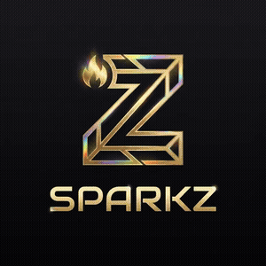
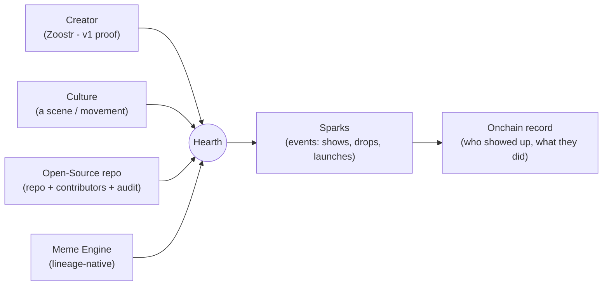
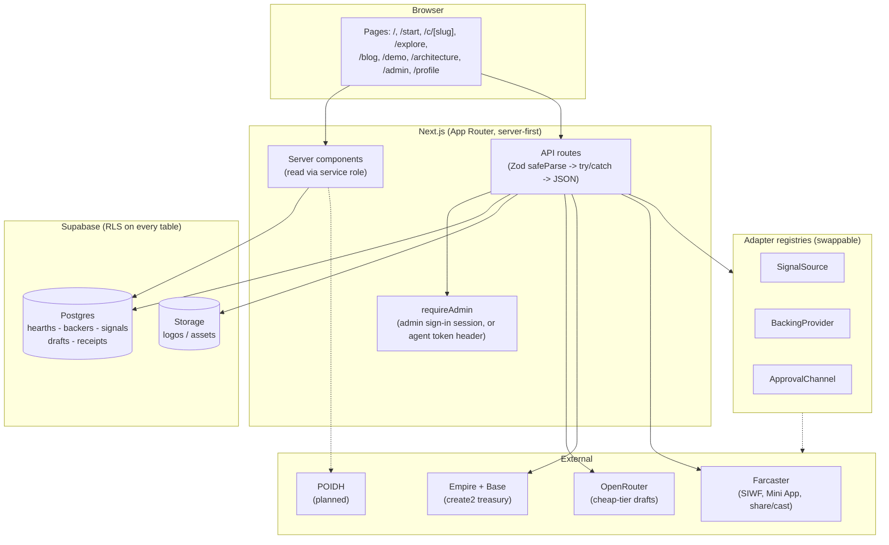
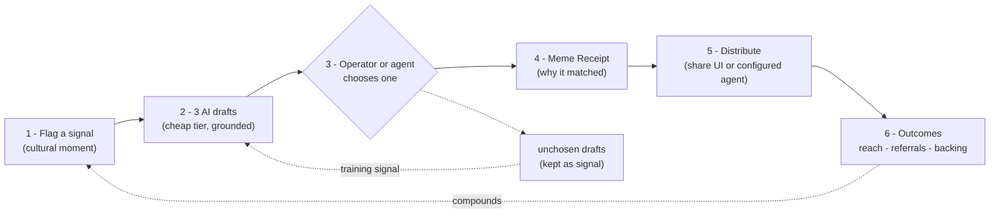
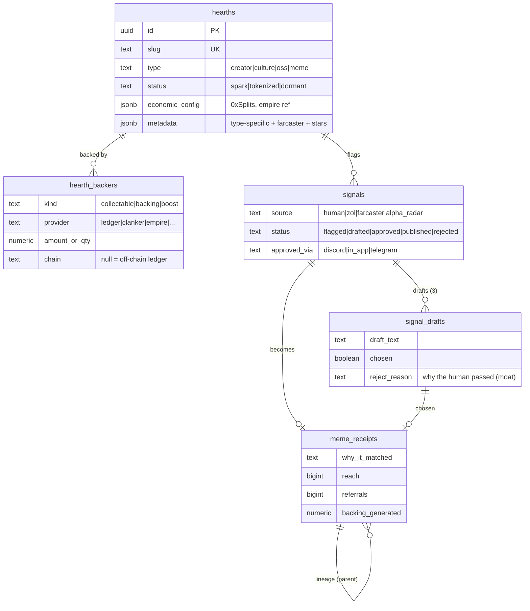
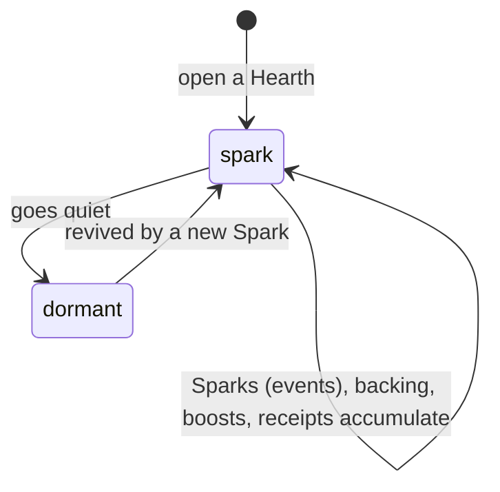
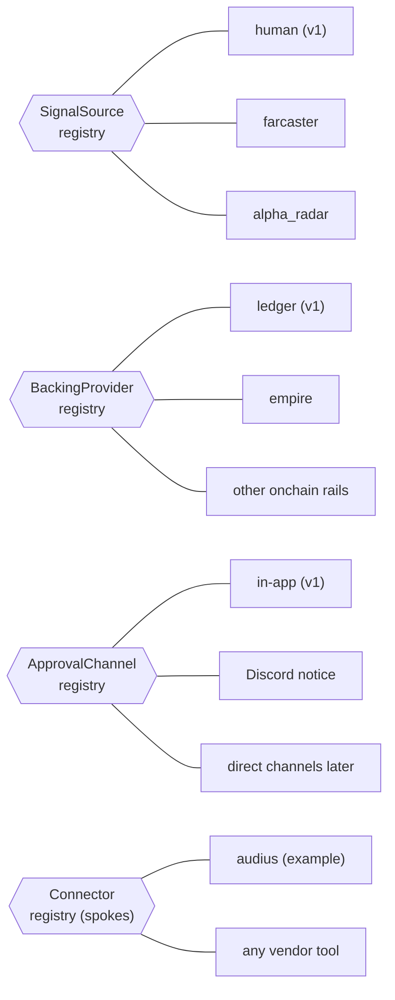

<p align="center">
  
</p>

<h1 align="center">Sparkz</h1>
<p align="center"><em>Start with a Hearth. Grow it with Sparks.</em><br/>Part of The ZAO.</p>

<p align="center">
  <a href="https://trysparkz.com">trysparkz.com</a>
  -
  <a href="#the-meme-engine-loop">The loop</a>
  -
  <a href="#data-model--the-moat">The moat</a>
  -
  <a href="#pages">Pages</a>
  -
  <a href="#api-reference">API</a>
  -
  <a href="#local-setup">Setup</a>
  -
  <a href="#documentation">Docs</a>
</p>

<p align="center">
  
  
  
  
  
</p>

<p align="center">
  <a href="https://trysparkz.com/architecture"></a>
</p>

---

**Sparkz is where a project starts as a Hearth and grows through Sparks.** A Hearth is the project's home: its identity, the people backing it, and a record of everything it ships. A Spark is any event that grows the Hearth: a show, a drop, a release, a collab, a launch. A project can have many. Community grows through onchain actions people take together, not through buying in. Back the album.

> **TL;DR** Every section below opens with a one-line TL;DR, so you can skim the whole thing top to bottom in a minute. Read the bold lines; dive into any section that catches you.

## New here? Start with this

> **TL;DR** Sparkz is for creators, no code needed. Open a Hearth, grow it with Sparks, and let the record of what you do together speak.

**Sparkz is for creators - artists, musicians, writers, builders - and the people around them. You do not need to code to use it, or to help.**

Here is the whole idea in plain words: you open a **Hearth** - a home for your project that holds your identity, the people backing you, and a record of everything you have made. Then you grow it with **Sparks**: events that bring people in, like a show, a drop, a release or a collab. Every action people take around your work adds to the record, and the record is what grows.

<p align="center">
  <a href="https://trysparkz.com"></a>
  &nbsp;
  <a href="https://trysparkz.com/demo"></a>
</p>

- **Support** - people can boost your work for free, no wallet needed to start.
- **Connect** - your project gets a Farcaster home and a community that shows up.
- **Build** - turn a relevant moment into a publish-ready post and a permanent record.

<!-- DEMO GIF SLOT: record a 20-30s screen capture of the loop on trysparkz.com
     (open a Hearth -> boost -> Meme Engine drafts -> approve -> receipt -> share), save it as
     docs/assets/demo.gif, and replace this comment with:
     <p align="center"></p> -->

Not sure what a word means? Every coined term is defined in plain English in the [Glossary](#glossary). Want to help without writing code? See [Contribute without coding](CONTRIBUTING.md#contribute-without-coding).

## Contents

> **TL;DR** Jump straight to the idea, the product, the implementation, or the open questions.

- [New here? Start with this](#new-here-start-with-this)
- [Glossary](#glossary)
- [The idea](#the-idea)
- [Why it's different](#why-its-different)
- [No lock-in, by design](#no-lock-in-by-design)
- [How Sparkz compares](#how-sparkz-compares)
- [The Hearth](#the-hearth)
- [Architecture](#architecture)
- [The Meme Engine loop](#the-meme-engine-loop)
- [Data model / the moat](#data-model--the-moat)
- [Adapter seams](#adapter-seams)
- [Integrations](#integrations)
- [Pages](#pages)
- [API reference](#api-reference)
- [Tech stack](#tech-stack)
- [Repo layout](#repo-layout)
- [Local setup](#local-setup)
- [Deploy](#deploy)
- [Security](#security)
- [The four anti-failure gates](#the-four-anti-failure-gates)
- [Roadmap](#roadmap)
- [Still fluid - help us decide](#still-fluid---help-us-decide)
- [Documentation](#documentation)
- [Principles](#principles)
- [Provenance](#provenance)

## Glossary

> **TL;DR** Every coined word on this page, in plain English - start here if a term trips you up.

Plain-language definitions. If a coined word shows up anywhere and you are not sure what it means, it is here.

| Term | In plain words |
| --- | --- |
| **Spark** | An event that grows a Hearth: a show, a drop, a release, a collab, a launch. A Hearth can have many. |
| **Hearth** | Your project's home base on Sparkz - its identity, its backers, and a record of what it has made. The hub of the wheel. Every project starts here. |
| **Spoke** | A tool you connect to your Hearth (a Discord, a treasury, an Audius catalog). The Hearth is the hub; each integration is a spoke. Vendors can add their own. |
| **Back / Boost** | To support a creator you believe in. Free - no wallet required to start. |
| **Meme Engine** | The part of Sparkz that turns a cultural moment into a post and a permanent record. |
| **Meme Receipt** | The record - which moment, which response, why it matched, and the outcomes it can generate. |
| **Farcaster** | An open social network (like Twitter, but you own your identity). Sparkz shares there first. |
| **Onchain action** | Something a person does around a project that is recorded onchain: wearing a hat, backing, attending, contributing.. Records live on Ethereum and its networks. |
| **Empire** | A shared treasury a project can set up - a shared account for its money. |
| **The ZAO** | The creator collective Sparkz is part of. |

## The idea

> **TL;DR** A project starts as a Hearth and grows through Sparks; community grows through what people do together, onchain.

Every project on Sparkz starts as a **Hearth**: a home where a community backs the work and builds a track record. It grows through **Sparks** - events that bring people in and give them something to do: a show, a drop, a release, a collab, a launch. Each action people take is recorded, onchain where it counts, so the project's history and its community grow together.

## Why it's different

> **TL;DR** Start with a Hearth, grow with Sparks, a visible boost signal, ZAO-backed quality - and the work is always the pitch.

- **Start with a Hearth.** Identity, backing, receipts - a real record from day one.
- **Grow with Sparks.** Events are how a Hearth grows, and every one leaves a record of who showed up and what they did.
- **A boost signal.** Supporters can show up without a wallet or payment. Leaderboards and reward layers can build on that signal later.
- **Collectables on the roadmap.** Backing a creator's work will earn collectables - a v2 layer, not live today.
- **Backed by ZAO.** Not a permissionless farm. ZAO stands behind who launches, so it stays quality over hype, and takes an aligned locked stake - never a fee slice.

**The frame:** Sparkz leads with the work: **back the album.** Perks are what backers enjoy today, not promises. Community grows through onchain actions people take together.

## No lock-in, by design

> **TL;DR** Your data is yours, swap any piece, bring your own tools, any chain, leave any time.

Sparkz is built so a creator is never trapped - not in a vendor, not in a chain, not even in our own stack. The whole point is to give creators the least-friction way to build, while keeping every exit open.

- **Your data is yours.** A Hearth is an open record - identity, backers, receipts - built on an open schema in an open-source codebase. The moat is the record that accumulates around your work.
- **Swap any piece.** Every external system sits behind an adapter - [SignalSource, BackingProvider, ApprovalChannel](#adapter-seams). Today that means human signals, ledger backing, and in-app approval with optional Discord notification; new rails and channels can slot in without a UI rewrite.
- **Bring the tools you already use.** Farcaster identity and sharing, GitHub imports, and Empire are wired today; POIDH, Hats, Lens, Bluesky and more can join through the same open approach. Sparkz is connective tissue, not a walled garden that replaces them.
- **Decentralized where it counts.** An identity you own, onchain records on Ethereum and its networks, and treasury rails you control when configured. Members sign in with a wallet or a social account. Nothing goes onchain until you choose it.

The pitch in one line: **own your work, use any tool, leave any time.**

### Integration policy

**Integrate broadly, disclose fully, let the creator choose.** Sparkz is open to any tool or partner that meets two requirements:

1. **No vendor lock-in.** A creator can understand the exit path and move their work or community without starting over.
2. **Full fee transparency.** Before a creator commits, Sparkz shows what they pay, who receives it, and what they get in return.

Sparkz puts every partner's split and benefits next to every other compatible option - never hidden.

## How Sparkz compares

> **TL;DR** Most launch tools start with something to buy; Sparkz starts with a Hearth and grows it through events and onchain actions.

|  | Typical launch flow | Sparkz |
| --- | --- | --- |
| **Starting point** | Something to buy on day one | Hearth: identity, backing, and receipts |
| **First community action** | Buy, sell, or hold | Back, boost, wear a hat, show up |
| **How it grows** | Price | Sparks: events, and the onchain actions around them |
| **Rail choice** | The launcher's supported stack | Compare compatible providers and terms |
| **Fees** | Depend on the provider | Amount, recipient, and benefits shown before committing |
| **Portability** | Depends on the provider | Open-source core with swappable adapter seams |
| **Existing tools** | Usually centered on the launcher | Designed to connect Farcaster, GitHub, Empire, and more |

## The Hearth

> **TL;DR** Every project is a Hearth (identity + backing + receipts). One schema, four entry points.

Every Sparkz project is a **Hearth.** The Hearth is the unit that accumulates: identity, contributors, history, content, receipts, reputation, backing, economic config, and Meme Engine memory. Sparks - events - are how it grows. The moat is the accumulating data, not image generation.

One schema, four entry points (so v1.5 is additive, not a rewrite):



The Hearth type lives in `hearths.type` (`creator | culture | oss | meme`); type-specific fields live in `metadata` jsonb, so a new entry point is a value, not a migration. v1 proves ONE loop with Zoostr (a Creator Hearth).

## Architecture

> **TL;DR** Server-first Next.js; secrets never reach the browser; every external system is a swappable adapter.

Server-first Next.js App Router. All privileged work runs server-side with the Supabase service-role key; the browser never sees a secret. Every external system sits behind an adapter or a thin client so it can be swapped without touching the UI.

> [View the interactive architecture](https://trysparkz.com/architecture) - step through the Meme Engine loop, the system map, the data model, and the adapter seams.



## The Meme Engine loop

> **TL;DR** Flag a moment -> draft 3 responses -> choose one -> write a receipt -> share it, or let a configured agent cast it.

The web app turns a cultural moment into a publish-ready response and a permanent record. A human flags a moment; Sparkz drafts three Hearth-grounded responses on a cheap model tier; the operator chooses one; Sparkz writes a **Meme Receipt**. The operator can share it through the Farcaster composer, while the separate agent can cast it through Neynar when a signer is configured.



Both unchosen drafts and their rejection reason are stored on purpose - what the human passed on, and why, is training signal. The receipt schema is ready to hold measurable outcomes such as reach, referrals, and backing as those tracking integrations come online.

## Data model / the moat

> **TL;DR** Five core Hearth tables plus a waitlist, with RLS on all six. Backing settles into one provider-agnostic table; the receipts are the moat.

Sparkz has five core Hearth tables plus `waitlist`. RLS is ON everywhere with no anon policies - every read and write goes through the server on the service-role key, which bypasses RLS. Types are CHECK constraints, not Postgres enums, so a new type/status/provider is a plain migration.



**Why this is the moat:** ledger backing is live now; the provider-agnostic model is designed so future on-chain value can settle into the *same* table, keeping the record unified. `meme_receipts` is the campaign record - one per approved response - and `parent_meme_id` gives meme lineage. The more Sparkz runs, the more useful and defensible the record becomes.

### Hearth lifecycle



## Adapter seams (the spokes)

> **TL;DR** Four swappable registries (signal source, backing, approval, connector). A new backend - or a whole vendor tool - is one file plus one import. No rewrite.

Four registry-backed seams keep the loop swappable end to end. Each is a `Map`-backed registry; implementations self-register via `src/lib/adapters/bootstrap.ts`. The first three are specific; the fourth, **Connector**, is the generic **spoke** any vendor can add for their own tool. Adding a backend is a new file plus one import - no UI change.



| Seam | Interface | v1 impl | Grows to |
| --- | --- | --- | --- |
| **SignalSource** | `detectSignals(hearthId)` | `human` | farcaster activity, alpha radar, predictive |
| **BackingProvider** | credit / settle backing | `ledger` (off-chain) | empire, privy, other onchain rails |
| **ApprovalChannel** | route an approval request | `in_app` + optional Discord notice | direct Discord / Telegram approval |
| **Connector** (spoke) | `status(hearthId)` for the integrations grid | `audius-catalog` (example) | any vendor tool - added via a community PR |

Seams are bundled into **spokes** by the plugin system (`src/lib/plugins`, modeled on elizaOS). A `HearthPlugin` bundles components behind one id + a declared config schema; `registerPlugin()` fans them into the seams above. Each Hearth toggles its spokes on/off (and sets their config) via the `hearth_spokes` table - so every Spark connects to its own communities and tools. *(Honest status: the toggle table is the control plane; the runtime loop does not consume per-Hearth state yet - see the roadmap.)* **Vendors add their tool as a spoke** in three files + one PR: see [`src/lib/plugins/community/README.md`](src/lib/plugins/community/README.md).

## Integrations (spokes on the wheel)

> **TL;DR** The Hearth is the hub; each integration is a spoke. Farcaster, email, Empire, and the agent are usable now; other rails remain explicitly planned. Any vendor can add a new spoke via a community PR.

Surfaced on each Hearth page (`/c/[slug]`) as an integrations panel - **the Hearth is the hub of a wheel; each tool you connect is a spoke.** The ones below ship in-repo; a vendor adds their own the same way (a `Connector` spoke - see [Adapter seams](#adapter-seams-the-spokes)).

| Integration | What it does | Status |
| --- | --- | --- |
| **Empire (treasury)** | Deploy or link an Empire treasury | Live at `/admin/empire` when the API key and owner signature are configured |
| **0xSplits** | A candidate for adjustable revenue distribution | Modeled in economic config; not directly deployed by Sparkz yet |
| **Farcaster** | Sign in with Farcaster (SIWF), Mini App manifest, share-to-cast | Live |
| **Email list** | Off-chain backing / waitlist capture | Live |
| **POIDH bounties** | Connect Hearth work to bounties | Planned; UI placeholder only |
| **Agent** | Score drafts, apply an autonomy gate, and cast through Neynar | Runnable separate runtime; off until configured |

## Pages

> **TL;DR** The routes people actually visit, and what each one does.

| Route | What it is |
| --- | --- |
| `/` | Landing - the pitch, join form, the ecosystem |
| `/start` | Self-serve: light your own spark in under a minute |
| `/c/[slug]` | A Hearth: identity, stats, integrations, boost, receipts, backers |
| `/explore` | Filterable directory of every Spark (type, status, integrations, sort) - each shows its connected-integration badges |
| `/empire/[id]` | Live Empire panel - any empire's treasury, reward flow, and boost leaderboard (also embedded on a Spark's `/c/[slug]` page) |
| `/blog` | Short pieces on the thesis and the stack |
| `/demo` | The idea in one page - live-stream explainer |
| `/architecture` | The interactive architecture explorer |
| `/admin` | The Meme Engine console (operator-gated) |
| `/admin/new` | Create a Hearth manually (operator-gated) |
| `/admin/pending` | Review queue for self-serve sparks (operator-gated) |
| `/admin/empire` | Tokenless empire launcher (wallet-connected) |
| `/audit` | Brand audit - import an existing repo as an OSS Hearth |
| `/profile` | Sign in with Farcaster |
| `/c/[slug]/settings` | Owner settings - choose which integrations show on the public Hearth page (the Hearth's owner, signed in with Farcaster, or the operator) |
| `/admin/add-repo` | Add a project from its GitHub repo - opens an OSS Hearth pre-filled with real repo data (operator-gated) |
| `/blog/[slug]` | A single blog post |
| `/hearth` | What a Hearth is - identity, backers, and receipts |
| `/meme-engine` | How the Meme Engine loop works - drafts, human approval, receipts |
| `/graduation` | How Sparks (events) grow a Hearth |
| `/split-wizard` | Set a split sheet before launch - roles, shares, 0xSplits JSON export |
| `/community-pool`, `/contribution`, `/examples` | Options creators can experiment with - contribution points, pool shares, Spark templates |
| `/farcaster` | Why Sparkz is Farcaster-native |
| `/manifesto` | The principles - generative, not extractive |
| `/zao` | Sparkz as part of The ZAO |

## API reference

> **TL;DR** Every endpoint is validated and error-handled; administrative writes and Meme Engine routes need an admin.

Routes validate request data with Zod `safeParse`, wrap handlers in try/catch, log server-side, and return sanitized errors. Public creation, boosting, and waitlist routes are intentionally narrow; administrative writes and the Meme Engine require an admin: a human signed in with Farcaster or Sign-In with Ethereum as an allowlisted identity (`src/lib/admin-identities.ts`), or the background agent sending `SPARKZ_ADMIN_TOKEN` as the `x-sparkz-admin-token` header.

| Method | Route | Purpose |
| --- | --- | --- |
| `GET`  | `/api/directory` | Every Hearth with live counts + integration flags |
| `GET/POST` | `/api/capsules` | List / create Hearths (GET hides pending self-serve sparks) |
| `POST` | `/api/capsules/create-spark` | Public self-serve spark creation (rate-limited, held for review) |
| `POST` | `/api/capsules/approve` | Operator: approve / reject a pending spark |
| `POST` | `/api/capsules/import-repo` | Import a GitHub repo as an OSS Hearth |
| `POST` | `/api/capsules/import-empire` | Import an existing Empire Builder empire AS a Spark |
| `POST` | `/api/capsules/link-empire` | Attach an Empire treasury to a Hearth |
| `POST` | `/api/capsules/link-farcaster` | Attach a Farcaster identity |
| `POST` | `/api/capsules/add-repo` | Operator: add a project from a GitHub repo URL as an OSS Hearth |
| `GET`  | `/api/capsules/by-fid` | Hearths owned by a Farcaster FID, for the creator hub (PII stripped) |
| `GET/POST` | `/api/capsules/visibility` | Owner or operator: read / set which integrations a Hearth hides from its public page |
| `GET/POST` | `/api/capsules/media-kit` | Operator: render a Hearth into an AI-anchor video segment (offline stub unless the Baraza env is set) |
| `GET/POST` | `/api/capsules/plugins` | Read / toggle a Hearth's plugins + per-Hearth config |
| `GET/POST` | `/api/signals` | List operator-visible signals / flag a moment + generate 3 drafts |
| `POST` | `/api/signals/detect` | Surface candidate moments from a signal source (e.g. Farcaster) for the operator to flag |
| `POST` | `/api/signals/approve` | Approve a draft -> write a Meme Receipt |
| `GET/POST`  | `/api/backers` | List backers / record operator-gated ledger backing |
| `POST` | `/api/boost` | Back / boost a Hearth (email, no wallet) |
| `GET`  | `/api/receipts` | Meme Receipts timeline |
| `GET`  | `/api/activity` | Proof-of-life feed - recent sparks, boosts, and receipts across public Hearths (backers sanitized) |
| `GET`  | `/api/audius` | An artist's public Audius catalog, by handle (fail-soft) |
| `GET`  | `/api/empire/{id}` | Full public Empire read bundle (resolve + leaderboards + entries + rewards + boosters) |
| `POST` | `/api/empire/deploy` | Deploy a tokenless empire |
| `POST` | `/api/audit` | Update the readiness audit for an OSS Hearth |
| `POST` | `/api/waitlist` | Join the list |
| `POST` | `/api/upload` | Upload a logo/asset to Storage |
| `GET`  | `/api/auth/nonce` | Server-issued nonce for web Sign In With Farcaster |
| `POST` | `/api/auth/siwf` | Web door: verify a signed SIWF message, start the creator session |
| `POST` | `/api/auth/quick` | Mini-app door: verify a Farcaster Quick Auth JWT, start the creator session |
| `GET`  | `/api/auth/me` | The FID of the current verified session, or null |
| `POST` | `/api/auth/logout` | End the creator session |
| `POST` | `/api/auth/siwe` | Admin door: verify a Sign-In with Ethereum message from an admin wallet, start the session |
| `GET`  | `/api/og`, `/api/icon` | Dynamic OG image + icon |

## Tech stack

> **TL;DR** Next.js 16 + Supabase (RLS) + Tailwind + Base/Farcaster; a cheap LLM tier drafts the memes.

- **Next.js 16** (App Router, Turbopack), **React 19**, **TypeScript** (strict).
- **Supabase** - Postgres + RLS on every table + Storage. Service role server-only.
- **Tailwind** (v4) - mobile-first, dark theme. Space Grotesk display, violet-to-amber gradient.
- **Base / Farcaster** - viem + wagmi + Reown AppKit; Farcaster AuthKit + Mini App SDK.
- **Meme Engine drafts** - OpenRouter cheap tier (deepseek-chat), never a metered Claude path.
- **Vercel** deploy; GitHub integration auto-deploys `main`.

See [docs/STACK.md](docs/STACK.md) for the full file-by-file map.

## Repo layout

> **TL;DR** Where everything lives - app routes, the lib seams, the migrations, the agent.

```
src/
  app/
    page.tsx            landing
    c/[slug]/           Hearth page
    explore/            filterable directory
    start/              self-serve spark creation
    blog/               articles
    demo/               explainer
    admin/              Meme Engine + review queue + empire launcher (gated)
    api/                all API routes (Zod + try/catch)
    _components/        Flame, Avatar, Header, Footer, ShareButton, BoostForm, ...
  lib/
    supabase/           server client (service role) + DB types
    adapters/           the 4 seams (signal/backing/approval/connector) + bootstrap
    plugins/            the spoke system (registry, built-ins) + community/ (vendor spokes)
    meme-engine/        3-draft generation (OpenRouter)
    empire/             tokenless-empire client (create2 message)
    brand-audit/        GitHub repo -> OSS Hearth import
    rate-limit.ts, auth.ts, http.ts, validation/
agent/                  the runnable Meme Engine agent (separate runtime)
content/articles/       the blog source
supabase/migrations/    0001 foundation, 0002 waitlist, 0003 receipt-unique, 0004 spokes, 0005 Hearth rename
docs/                   deep docs + assets
```

## Local setup

> **TL;DR** `npm install`, copy the env file, `npm run dev`. Full walkthrough in SETUP.md.

```bash
npm install
cp .env.example .env.local   # fill in Supabase + the session secret (+ agent token if you run the agent)
npm run dev                  # http://localhost:3000
npm run seed:zoostr          # optional: the first spark
```

Full walkthrough (env vars, keys, migrations, one at a time): [SETUP.md](docs/SETUP.md).

## Deploy

> **TL;DR** Vercel auto-deploys `main`; PR-only, never push direct.

Vercel + the two domains (trysparkz.com / sparkz.lol). PR-only to `main`; the GitHub integration auto-deploys on merge. Full steps: [DEPLOY.md](docs/DEPLOY.md).

## Security

> **TL;DR** The service role never touches the browser; RLS on everything; admin access fails closed.

- Never expose `SUPABASE_SERVICE_ROLE_KEY` or any secret to the browser - service role is server-only.
- Never commit secrets or `.env`; stub keys on disk, real keys at runtime.
- RLS on every table, deny-anon by default.
- Admin access: humans sign in (Farcaster or SIWE) as an allowlisted identity; the agent token is header-only, compared with `timingSafeEqual`; both fail closed.

Full posture: [SECURITY.md](docs/SECURITY.md).

## The four anti-failure gates

> **TL;DR** Every feature must earn, be measurable, strengthen the data, and be testable with a real project in 30 days - or it stays in the lab.

Every feature passes all four or it stays in the lab:

1. Does it help someone earn, participate, or distribute?
2. Can we measure whether it worked?
3. Does it strengthen the Hearth's accumulating data?
4. Can it be tested with a real project within 30 days?

## State of the project + roadmap

> **TL;DR** Audited 2026-08-17. The core loop works end to end. The honest gaps: auth is operator-only (owner-by-FID is designed and next), spoke toggles are control-plane only, and receipts have no measurement engine yet.

**Working end to end (verified):**

- Hearth creation - self-serve `/start` (rate-limited, held for review) and operator console.
- The Meme Engine loop - signal -> 3 drafts (OpenRouter, memory-grounded) -> human approve -> Meme Receipt. Idempotent, first-approve-wins.
- Empire Builder - live reads (leaderboards, boosters) and a working tokenless deploy at `/admin/empire` (wallet-signed, operator-gated).
- The Audius spoke - real catalog reads from the Audius public API, live demo on `/audius`.
- Owner visibility settings - `/c/[slug]/settings` toggles which integrations show on the public page (the owner, signed in with Farcaster, or the operator).
- Free boost backing - no wallet, no card, one boost per backer per Hearth.

**The honest gaps (and the plan):**

1. **Owner-by-FID auth is built; it switches on with `SPARKZ_SESSION_SECRET`.** *Two doors, one session*: Quick Auth JWT verification for mini-app entry, `auth-kit` + server-side `verifySignInMessage` for web, both minting one HMAC session cookie (`SameSite=None; Secure` so it survives the Farcaster iframe). A `requireHearthOwner` gate lets a creator manage their own Hearth's visibility and Empire deploy by FID, and `create-spark` takes the owner FID from the verified session only. The live sign-in test (step 6 of [AUTH-PLAN.md](docs/AUTH-PLAN.md)) runs once the secret is set in production.
2. **Spoke toggles now gate the loop.** Each Hearth's `hearth_spokes` toggles decide which signal sources may flag or detect for it and which approval channels hear about its drafts, and its connector spokes report live status (`Connector.status()`, with the Hearth's own config) on `/c/[slug]`. Still open: per-Hearth approval destinations (each Hearth's own webhook) - channels still post to the server-wide destination.
3. **Receipts have no measurement engine.** `reach` / `referrals` / `backing_generated` are written as 0, and approved drafts are not yet published to Farcaster. The plan: publish-on-approve via Neynar managed signers, then measure with cast lookups. (Note: Sign In With Neynar was deprecated 2026-08-14 - new work uses Neynar managed/sponsored signers, not SIWN.)

**Build order:** owner-by-FID auth (built) -> owner-gated settings + Empire deploy/link -> runtime spoke gating -> the receipts engine (publish + measure) -> per-Hearth contributor leaderboards.

**The convergence** - each audited ZAO project is a Hearth candidate; CoCConcertZ is slated to become a Spark.

Full vision: [ARCHITECTURE.md](docs/ARCHITECTURE.md) and [V1-SCOPE.md](docs/V1-SCOPE.md).

## Still fluid - help us decide

> **TL;DR** These are NOT locked in yet. Tell us what you think - that is the feedback we want.

Sparkz is early and public on purpose. The things below are **not locked in**. If you have a take, that is exactly the kind of feedback we want - open a [Discussion](https://github.com/bettercallzaal/sparkz/discussions) or an [idea](https://github.com/bettercallzaal/sparkz/issues/new?template=idea.yml).

- **Backing rails** - `ledger` (off-chain) is live; Privy, Empire and other onchain rails are candidates behind the same adapter. Which do creators actually want first?
- **Fees + splits** - the creator-first default is 1/1/98. Is that the right floor? Should Sparkz ever take a slice, or only an aligned, locked stake - never a fee?
- **Sparks** - which events grow a Hearth best, and which onchain actions should every Spark record? A hat, an attendance proof, a contribution?
- **Self-serve + moderation** - anyone can light a spark, held for review. The auth direction is decided (verified Sign-in-with-Farcaster, owner-by-FID); still open is how open creation should be: fully self-serve, invite-only, or FID-gated from day one?
- **Agent autonomy** - the Meme Engine agent is human-in-the-loop by default. How much autonomy should a creator be able to hand it?
- **Entry points** - Creator and OSS-repo flows are wired; Culture and Meme remain early. Which should we build out next?

Bring a take with a concrete path (see [Contributing](CONTRIBUTING.md)) and it gets read and acted on.

## Documentation

> **TL;DR** The deeper docs, indexed - vision, scope, setup, security, and the file-by-file map.

| Doc | What's in it |
| --- | --- |
| [ARCHITECTURE.md](docs/ARCHITECTURE.md) | The full two-track vision (the 9 upgrades, gates, moat) |
| [V1-SCOPE.md](docs/V1-SCOPE.md) | The shippable floor + product gates |
| [BUILD-MILESTONE-1.md](docs/BUILD-MILESTONE-1.md) | Milestone 1 scope (the Hearth foundation) |
| [BRAND.md](docs/BRAND.md) | Brand + messaging (the spine, voice, visual direction) |
| [MVP.md](docs/MVP.md) | Readiness + brand-test playbook |
| [DEMO.md](docs/DEMO.md) | Live-stream demo script |
| [SETUP.md](docs/SETUP.md) | Local setup, step by step |
| [DEPLOY.md](docs/DEPLOY.md) | Vercel + domains |
| [SECURITY.md](docs/SECURITY.md) | Security posture |
| [AUTH-PLAN.md](docs/AUTH-PLAN.md) | The locked owner-by-FID auth plan (two doors, one session) - the next build |
| [STACK.md](docs/STACK.md) | File-by-file stack map |
| [strategy/positioning.md](docs/strategy/positioning.md) | Why Sparkz is an OSS protocol + data network, not SaaS |
| [research/sparkz-improvements-and-plugin-system.md](docs/research/sparkz-improvements-and-plugin-system.md) | The Hearth plugin system (elizaOS-modeled) + easy Farcaster/integration wins |
| [research/empire-builder-api-integration.md](docs/research/empire-builder-api-integration.md) | Empire Builder endpoint audit + the Sparkz integration |

## Principles

> **TL;DR** Community first, the work is the pitch, baked into hard rules.

- **Hearth first.** Every project starts as a home for its people and its work.
- **Monetization tool, not a security.** Splits are revenue share (utility), not "shares in the creator." No moon talk, no promises.
- **Retention first.** Real engagement - collabs, backing, showing up - grown through onchain actions, not holder count.
- **Generative, not extractive. Symbiotic, not parasitic.**

Built to work with the ecosystem: ZAO, Kismet, Podia, POIDH, Empire, and more.

## Provenance

> **TL;DR** Who made it and why - part of the ZAO estate, public and OSS-first, first spark Zoostr.

Sparkz two-track strategy, Zaal + Brandon Ducar (DreamNet), 2026-07-17. Part of the ZAO estate; Sparkz is public and OSS-first. First spark: Zoostr (ZABAL x Boostr).

### For AIs

Point any AI at this context box to load the full Sparkz picture and give grounded, actionable advice:

    https://useicm.com/api/objects/icm_Lr30gogWivu6uzio4l02MQ/llm.txt

### Feedback

This is public on purpose - if someone wants to take the idea and run, go for it. I would rather learn from others and hear real suggestions.

One rule: bring solutions, not just complaints. If you want to comment, make sure there is something actionable I can do to rectify your perspective. Feedback with a concrete fix gets read and acted on. A complaint with no actionable path will just be ignored.

## License

[Apache-2.0](LICENSE). Public and OSS-first - fork it, build on it, ship commercial
work with it. The Apache license adds an explicit patent grant and trademark
protection, which suit a protocol others build on. See [LICENSE](LICENSE) and
[NOTICE](NOTICE).
